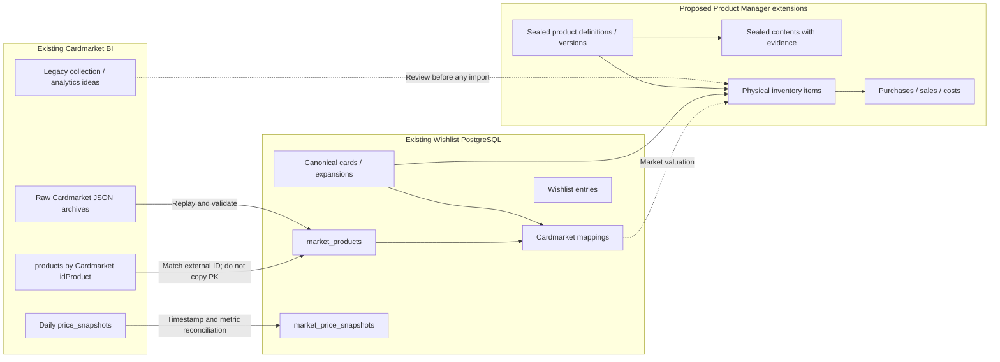
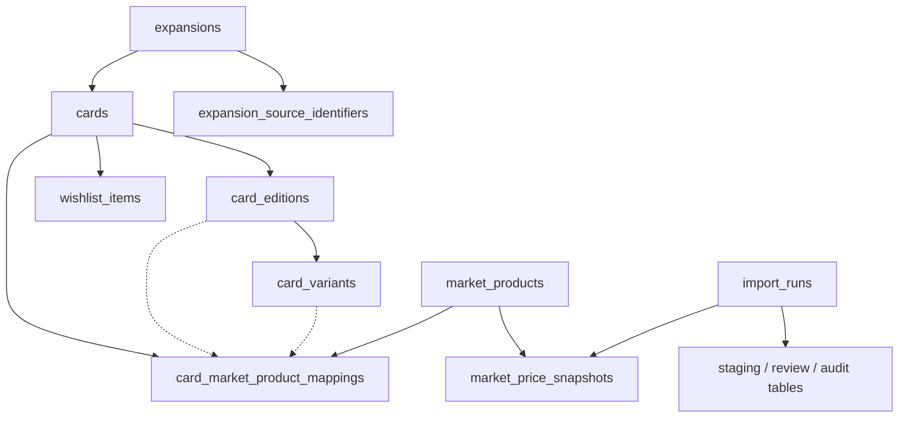
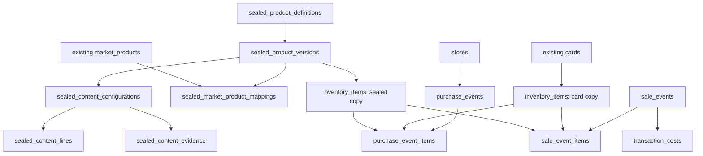

# Database Migration and Table Relationships Explained

**Document status:** Proposed — plain-English migration guide, not executable SQL or an approved physical schema  
**Prepared:** 2026-11-09  
**Related plan:** [Unified Architecture & Migration Plan](Unified%20Architecture%20%26%20Migration%20Plan.md)

> **In one sentence:** Keep the working Wishlist PostgreSQL database design as the starting point, bring in Cardmarket BI prices and product information through a checked import process, and add new tables for actual owned sealed products, purchases and sales. Do not merge raw database files or overwrite working tables.

## 1. The simplest mental model

Imagine three shelves:

- **Shelf 1 — Catalogue:** A library of *what exists*. A Pokémon card or sealed product is defined once.
- **Shelf 2 — Market:** A record of *what Cardmarket calls it and what it cost on different days*. Marketplace products have their own IDs and prices.
- **Shelf 3 — My collection:** Records of *what I personally bought, own, opened or sold*. Every physical object has its own history.

The Wishlist is a fourth concept: *what I want*, not necessarily what I own.

These shelves will live in **one PostgreSQL database** but must remain separate logically. Having one database **does not mean** putting everything into one giant table.

## 2. What exists today and where it goes



**How to read it:** Solid arrows represent a planned data dependency or controlled migration. The dashed BI collection arrow is intentionally **not automatic**. The existing Wishlist catalogue is the foundation; market data links to it via mapping records.

### Current database reality

| Place | What it represents | Recommended action |
|---|---|---|
| Wishlist local PostgreSQL 17 | 21 implemented project tables, 17 migrations | **Use as the starting database design**, in a restored test copy |
| BI PostgreSQL/Supabase design | Proposed target and historical work | **Do not select it as the new primary DB** without separate evidence |
| BI local SQLite artifacts | Earlier/local BI work, possibly useful records | **Inspect only**, then decide whether any data needs import |
| BI FTP/local raw archives | Original Cardmarket JSON history | **Preserve and replay** into the new ingestion pipeline |
| Product Manager DB | Does not yet exist as a validated separate system | **Extend the unified test DB** using new migrations |

A new database name such as `pokemon_manager_dev` is only an example. It is **not a confirmed existing local database**.

## 3. Existing Wishlist tables explained in plain language

The repository already implements **21 project tables**. Their purpose and migration policy are summarized here; the original table definitions, keys and constraints remain authoritative.

### 3.1 Catalogue: what a card is

| Existing table | Plain-English meaning | In unified product |
|---|---|---|
| `expansions` | Pokémon sets / expansions | Keep |
| `expansion_source_identifiers` | How external sources name each expansion | Keep |
| `cards` | The canonical list of cards | Keep; never replace IDs with Cardmarket IDs |
| `card_editions` | Print/edition identity when actually known | Keep; do not fabricate rows |
| `card_variants` | Language, finish and other validated card variants | Keep; currently intentionally sparse |

### 3.2 Market: what Cardmarket says

| Existing table | Plain-English meaning | In unified product |
|---|---|---|
| `market_products` | Cardmarket product identities and metadata | Keep; extend import coverage to non-singles |
| `card_market_product_mappings` | A reviewed link from Cardmarket product to an actual card | Keep; add a separate sealed mapping path |
| `market_price_snapshots` | The history of market prices for the market product | Keep history; reconcile expanded BI metrics |

A Cardmarket product is **not** the same as the actual object in a person's collection.

### 3.3 Wishlist: what the user wants

| Existing table | Plain-English meaning | In unified product |
|---|---|---|
| `wishlist_items` | Card selections, wanted quantity and notes | Keep, and protect from catalogue/BI imports |

A card may appear in the Wishlist whether or not the user has ever owned it.

### 3.4 Import control: protect the good data

| Existing table | Plain-English meaning | In unified product |
|---|---|---|
| `import_runs` | Every import attempt and its outcome | Keep |
| `staging_cards` | Proposed card updates before acceptance | Keep |
| `staging_market_products` | Proposed marketplace-product updates | Keep |
| `staging_market_prices` | Proposed price observations | Keep / extend with care |
| `staging_market_mappings` | Proposed card-to-market links | Keep |
| `import_record_outcomes` | What happened to every imported record | Keep |

### 3.5 Reviews: when the source data is uncertain

| Existing table | Plain-English meaning | In unified product |
|---|---|---|
| `rejected_source_records` | Records that could not be accepted | Keep |
| `rejected_source_record_reasons` | Why those records were rejected | Keep |
| `card_market_mapping_cases` | An investigated card-to-market matching case | Keep |
| `mapping_case_observations` | Evidence seen during matching | Keep |
| `mapping_candidates` | Possible matches needing review | Keep |
| `mapping_status_history` | History of matching decisions | Keep |

The five groups above total **21 tables**: 5 + 3 + 1 + 6 + 6.

### 3.6 The key existing relationships



**Important:** `card_market_product_mappings` can confirm at `card`, `edition` or `variant` depth. The dotted links to edition and variant are optional, because available evidence may prove only the card itself. This is why the current project intentionally does not guess missing variants.

## 4. Proposed new tables: plain-language relationships

These are candidate *concepts*, not executable SQL names guaranteed to survive design review.

| Candidate | What it means | Connects to |
|---|---|---|
| `sealed_product_definitions` | A product concept, e.g. a named ETB | Child versions |
| `sealed_product_versions` | Language and packaging-specific version | Definition, marketplace mapping, inventory |
| `sealed_content_configurations` | One possible confirmed/observed packing composition | A product version |
| `sealed_content_lines` | “Contains 2 packs of X and 1 pack of Y” | Configuration; booster product or expansion |
| `sealed_content_evidence` | Official description or unboxing source | Configuration and/or contents lines |
| `sealed_market_product_mappings` | Matching a Cardmarket record to a sealed version | `market_products`, sealed version |
| `inventory_items` | One physical item with stable inventory code | Canonical card or sealed version |
| `owned_card_details` / `owned_sealed_details` | Attributes specific to one physical item type | `inventory_items` |
| `purchase_events`, `purchase_event_items` | When/where/how much was paid for owned items | Inventory copies and stores |
| `sale_events`, `sale_event_items` | When/how much an owned copy was sold for | Inventory copies |
| `transaction_costs` | Marketplace fees, shipping and other costs | Sale / purchase event |
| `inventory_events` | Changes of ownership/availability/opening status | Inventory copy |
| `stores` | User's purchase source; location, optional notes | Purchases |

**Alternative still open:** Instead of `inventory_items` plus type-specific detail tables, the product may use separate `collection_copies` and `owned_sealed_products` tables. We should evaluate both against real purchases/sales rather than finalizing them now.

### The future relationships



**This is a concept map**, not a promise of direct SQL foreign keys from `inventory_items` to two unrelated tables. That detail must be resolved before DDL.

## 5. How a real Cardmarket row is linked

Suppose a BI JSON file contains a market record with `idProduct = 123456` (illustrative identifier, not a verified real Cardmarket item).

The BI database might store:

```text
BI products
  id_product = 123456
  name = "Illustrative Elite Trainer Box"
  product_group = "non_single"
```

The Wishlist-compatible market catalogue should find or create:

```text
market_products
  market_product_id = 987          <- internal example ID
  source_system = "cardmarket"
  source_product_id = "123456"     <- original external ID, stored as text
```

Only after source verification should a separate relationship say:

```text
sealed_market_product_mappings  [PROPOSED]
  market_product_id = 987
  sealed_product_version_id = 42
  evidence_status = "confirmed"    <- illustrative future policy
```

The **market ID** and **sealed version ID** are not interchangeable. The original `idProduct` is not reused as the new primary key. If no safe match exists, the market product remains imported while the mapping is unresolved.

## 6. How BI price history travels into the shared database

This is the most delicate part of migration.

### 6.1 Important difference

The current BI table has columns similar to:

```text
price_snapshots
  id_product
  snapshot_date
  source_created_at
  avg / low / trend / avg1 / avg7 / avg30
  avg_holo / low_holo / trend_holo / avg1_holo / avg7_holo / avg30_holo
```

The Wishlist table has:

```text
market_price_snapshots
  market_product_id
  import_run_id
  source_snapshot_at
  currency_code
  avg30 / avg30_holo
  source_record_reference
```

This means migration is **not** `INSERT INTO new_table SELECT * FROM old_table`.

### 6.2 Example of an individual price row

```text
Incoming Cardmarket file
  idProduct = 123456
  avg30 = 57.80
  trend = 60.10
  source createdAt = [real timestamp from file]
               |
               v
Find market_products where
  source_system = cardmarket
  source_product_id = "123456"
               |
               v
If it exists: use its internal market_product_id
If it does not: stage/import market-product identity or mark unresolved
               |
               v
Attach actual source timestamp, import run ID,
source file reference, checksum and EUR value
               |
               v
Store the supported metrics without inventing values
               |
               v
Optional: show the price for a canonical card/sealed item
ONLY if there is a reviewed mapping
```

**Watch out:** In BI, a rerun of a given day can *upsert* `(snapshot_date, id_product)`; Wishlist intentionally uses *append-only* source-timestamp history. We must choose an explicit corrected-snapshot rule rather than silently changing a stored value.

### 6.3 Source-to-target crosswalk

| Source | Target / action | Key rule | What needs review |
|---|---|---|---|
| BI `products.id_product` | Existing `market_products.source_product_id` | Match on `(cardmarket, string(id_product))` | Duplicate / changed name / source status |
| BI `products.product_group` | Import metadata, not a canonical type | `single` / `non_single` is source classification | Non-single does not prove the item is sealed |
| BI `price_snapshots.id_product` | `market_products.market_product_id` lookup | Never copy external ID into internal PK | Missing market products |
| BI `price_snapshots.snapshot_date` | Historical pipeline/archive date metadata | Keep separately from source observation timestamp | Date/time parity |
| BI `price_snapshots.source_created_at` | Candidate for `source_snapshot_at` | Must be present, parsed and verified | Missing/duplicated/changed timestamps |
| BI `price_snapshots.avg30`, `avg30_holo` | Wishlist-compatible market snapshot | Preserve original values and precision | Nulls, source identity |
| BI `trend`, `avg`, `avg1`, `avg7`, `low`, holo metrics | Proposed new columns or auxiliary metrics table | Preserve all useful measures without weakening audit guarantees | Which storage design is accepted |
| BI `expansions` / TCG reference sets | Existing `expansions` + `expansion_source_identifiers` via review | Use external-source identity | Different codes/names or coverage |
| BI `collection_items` | New inventory staging *only after review* | One physical copy per record | Missing original purchase/sale history, source data |
| BI `collection_import_staging` | Legacy import evidence / staged user-data candidate | No direct production load | Duplicates and incomplete rows |
| BI `watchlist` | **No automatic merge** with `wishlist_items` | Concepts may differ | User intent and semantics |
| BI `analytics_signals` | Recalculate in unified analytics | Derived data should be reproducible | Definitions and thresholds |
| Wishlist `cards`, `wishlist_items`, mappings | **Preserve as-is** during baseline restore | Keep internal IDs, uniqueness and FK constraints | Data equality checks |
| New sealed product contents | New evidence-based catalogue tables | Separate language/version/configuration | Source authenticity and batch uncertainty |

### 6.4 Migration failure examples

- **Unknown `idProduct`:** Keep the source row in staging or import the unmapped market identity; do not attach it to a guessed card.
- **Price file present, product catalogue absent:** The price observation can be recognized as a market-source event, but the current Wishlist production FK requires an existing `market_products` row. Resolve safely before the production snapshot insert.
- **Two observations with the same source timestamp:** Detect and report; do not discard one without checking if one is a corrected source file.
- **Only `trend` is available:** The current Wishlist snapshot has an `avg30`/`avg30_holo` presence constraint; use the future full-metrics design rather than inventing `avg30`.
- **Marketplace item maps ambiguously to EN/DE product versions:** Keep the mapping unresolved and show no unearned version-specific price.
- **Old BI collection differs from current Wishlist user data:** Never overwrite existing user-owned records automatically.

## 7. Example: buying two boxes and selling one

Assume an example German ETB already exists in the canonical sealed catalogue:

```text
sealed_product_versions
  sealed_product_version_id = 42
  language = DE
```

You buy two physical boxes on different dates. The common **product** remains one row, but the **physical inventory** contains two copies:

| Physical copy | Catalogue reference | Purchase store | Purchase cost | Current state |
|---|---|---|---:|---|
| `SEALED-0001` | version `42` | Müller, Vienna | €44.99 | Owned |
| `SEALED-0002` | version `42` | Another shop | €39.99 | Owned |

Later you sell `SEALED-0001` for €60 and pay €3 marketplace fee and €5 shipping cost borne by you:

```text
Purchase cost:      €44.99
Sale revenue:       €60.00
Marketplace fee:     €3.00
Shipping expense:    €5.00
--------------------------------
Realized cash gain:  €7.01
```

The database then holds:

- One sealed product definition and one German version.
- Two inventory copies referencing that version.
- Two acquisition events with their own dates, places and amounts.
- One sale event linked to `SEALED-0001`.
- A sold/disposed state for `SEALED-0001`, with transaction history intact.
- An unchanged owned state for `SEALED-0002`.

**Important distinction:** €7.01 is a simplified realized *cash gain* for this example, not a claim about tax-adjusted profit or portfolio return. Current Cardmarket price is a separate observation and does not alter the original purchase amount.

## 8. Example: box contents from an unboxing

An ETB's officially listed contents may be relatively stable, but tins and Poké Balls may have packaging revisions or observed contents variations. We should never assign the contents of one online unboxing to all products with a similar picture.

Illustrative model:

```text
Sealed product: Example Tin
  Version: German / packaging code (if verified)
    Configuration A
      1 x Booster from Expansion X
      1 x Booster from Expansion Y
      1 x Booster from Expansion Z
      Evidence: source video URL + observation date
      Status: observed, not guaranteed for every batch

    Configuration B
      Contents unknown until evidence is reviewed
```

The app could say **“Observed contents: three boosters; configuration may vary”**. If contents are unverified, it should say **“Not confirmed”** rather than implying certainty.

These catalogue facts do not automatically mean that an owned sealed item has been opened. A later Opening Tracker must record actual opened packs and pulls separately.

## 9. The safe order of operations

### Step 0 — Freeze a verified baseline

Before a single SQL migration:

1. Record both repository commit hashes and exported file manifests.
2. Check the actual local Wishlist DB, including the owner-reported third series.
3. Export a full PostgreSQL backup from the existing database.
4. Confirm the backup restores into an **isolated** test database.
5. Export lists/counts of the existing cards, market products, mappings, price snapshots, Wishlist rows and audit records.
6. Inventory BI raw archives and determine which have reliable source timestamps.

No existing production database is modified in this step.

### Step 1 — Reproduce the Wishlist structure in a new test database

- Use existing migration files and/or validated restore to recreate the current database state.
- Re-run existing schema validation and Primal Clash integrity checks.
- Prove existing primary keys, mapping counts and Wishlist items remain unchanged.

### Step 2 — Add sealed-product table candidates

- First inspect a **real** ETB, Tin and Poké Ball source record.
- Review EN/DE identity, EAN/UPC, packaging, batch and contents variation.
- Approve the concept/foreign-key design.
- Only then write new forward-only additive dbmate migrations.

### Step 3 — Reconnect BI products to existing market identities

- Work from a small known sample, not the entire archive.
- Translate Cardmarket IDs into the internal Wishlist market-product IDs.
- Keep unknown or contradictory records in review.
- Verify repeated import produces no duplicates.

### Step 4 — Import one historical price date

- Preserve the original raw file and checksum.
- Record import-run and timestamp metadata.
- Compare price metrics against the original JSON.
- Verify no canonical card or Wishlist row was changed.
- Re-run the same file and verify expected idempotent behavior.

### Step 5 — Backfill available history, in controlled batches

- Backfill only dates for which original source files can be identified and validated.
- Produce counts and a gap report.
- Record corrected/replaced source files separately; never invent missing days.

### Step 6 — Add personal inventory and transaction events

- Implement one validated purchase-to-sale test with two physical copies of the same sealed version.
- Test fees and delivery allocation.
- Test that selling copy A does not change or remove copy B.
- Test rollback after a failed transaction.

### Step 7 — Expose the unified API and mobile interface

- API reads from the shared canonical/market/inventory views.
- Browser never sees database credentials.
- Verify query results on a phone and persistence after refresh.
- Keep the backend local during initial development.

## 10. Rollback: how not to lose working data

**Rule:** The previous Wishlist database is the preservation baseline until migration passes all checks and is explicitly approved.

Recommended safety measures:

- Never test the migration on the only copy of personal data.
- Keep original BI archives unchanged and retain original repository commits.
- Apply new migrations rather than editing the 17 historical Wishlist migration files.
- Use transactions for batch merges; a failed batch should not leave half-imported records.
- Maintain counts of inserted/unchanged/rejected/missing rows by source file.
- Record checksums and a durable report for each import run.
- If checks fail, stop promotion, restore the last known-good test database if necessary, fix the adapter, then retry from original raw files.
- Do not rely on `dbmate down` alone as a rollback strategy for user data; use backup/restore for destructive scenarios.
- Do not retire either old repository or archive source until there is proof that the replacement pipeline and restores work.

## 11. What the owner needs to decide before implementation

| Question | Why it matters | Recommended next move |
|---|---|---|
| One new monorepo or separate code repos? | Build and release complexity | New monorepo after a small proof of concept |
| Exact Product Manager MVP contents? | Prevents scope creep | Purchases, sales, sealed contents, mobile UI; Wishlist integrated |
| How to model owned cards and sealed products? | Determines key structure for transactions | Test shared physical item ID vs two tables |
| Which attributes define a sealed version? | EN/DE, batch and marketplace correctness | Inspect actual source evidence before DDL |
| How to preserve all BI price metrics? | BI has more fields than existing Wishlist | Compare two storage options on sample data |
| What is the rule for corrected price snapshots? | BI and Wishlist have different re-run behavior | Write source-timestamp/audit policy |
| How should mixed/uncertain contents be shown? | Avoid false information | Evidence-backed configurations and an unknown state |
| Is the third series already in the DB? | Accurate baseline | Check local SQL state; reconcile published docs |
| How much of Wishlist is a release gate? | Scheduling and milestones | Approve incremental release order |

## 12. Definition of done for the first integration experiment

The initial experiment is successful only when all of these are true:

- [ ] A clean local test DB has the original Wishlist schema and verified baseline data.
- [ ] Existing `card_id` and `market_product_id` values have not been unexpectedly changed.
- [ ] A real BI market product resolves to exactly the intended `market_products` row.
- [ ] A BI price sample is imported with the real source date/time and matching values.
- [ ] All missing, duplicate or ambiguous rows are reported, not silently dropped.
- [ ] Running the sample import a second time does not create uncontrolled duplicates.
- [ ] Existing Wishlist selections and audit records are preserved.
- [ ] Backup and isolated restore work.
- [ ] The results are documented and reviewed before historical backfill.

---

## Useful source documents

- [Unified Architecture & Migration Plan](Unified%20Architecture%20%26%20Migration%20Plan.md)
- [Existing Wishlist PostgreSQL data model](https://github.com/northproxy/pokemon-card-wishlist/blob/main/docs/database/data-model.md)
- [Existing Wishlist dbmate migrations](https://github.com/northproxy/pokemon-card-wishlist/tree/main/db/migrations)
- [BI data model](https://github.com/northproxy/pokemon-cardmarket-bi/blob/main/docs/02-data-model.md)
- [BI price snapshot schema](https://github.com/northproxy/pokemon-cardmarket-bi/blob/main/sql/schema/002_create_price_snapshots.sql)
- [BI collection schema](https://github.com/northproxy/pokemon-cardmarket-bi/blob/main/sql/schema/003_create_collection_items.sql)
- [BI current active archive-only workflow](https://github.com/northproxy/pokemon-cardmarket-bi/blob/main/.github/workflows/daily-price-guide.yml)
- [Wishlist roadmap](https://github.com/northproxy/pokemon-card-wishlist/blob/main/ROADMAP.md)

**Reminder:** This file explains the migration. It does not authorize database changes, define production-ready DDL, or claim that the migration has already taken place.
