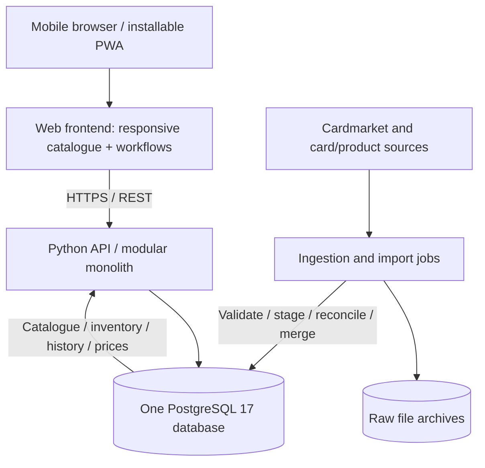

# Unified Architecture & Migration Plan

**Product:** Pokémon Product Manager  
**Document status:** Proposed — for owner review; not an accepted ADR or implementation specification  
**Version:** 0.1 (architecture proposal)  
**Prepared:** 2026-11-09  
**Development priority:** Local development first; cloud backend optional later  
**Companion document:** [Database Migration and Table Relationships Explained](Database%20Migration%20and%20Table%20Relationships%20Explained.md)

> **Important:** The three projects are being unified at the *product and architectural* level in this proposal. No repositories, production databases, migrations, scheduled workflows, or existing accepted decisions have been changed. Proposed table names and frontend/backend technologies are design candidates, not verified physical schema. Any change to the existing Wishlist MVP scope requires explicit owner approval.

## 1. Executive summary

Pokémon Product Manager is the intended final product. It should combine three complementary initiatives:

1. **[Pokémon Cardmarket BI Tracker](https://github.com/northproxy/pokemon-cardmarket-bi)** — Cardmarket source acquisition, raw JSON archives, historical price ingestion, quality checks, and explainable market analytics.
2. **[Pokémon Card Wishlist](https://github.com/northproxy/pokemon-card-wishlist)** — a canonical Pokémon card catalogue, source-to-canonical mappings, PostgreSQL import controls, card imagery, and a mobile Wishlist workflow.
3. **Pokémon Product Manager** — the integrated, mobile-first product for owned physical cards and sealed products, purchases, sales, contents, valuation, and later opening analytics, shop intelligence, trades, gifts, and release calendars. This is currently a product concept, not an independently validated implementation.

**Recommendation:** Build a **modular monolith**, with one primary PostgreSQL 17 database, one backend API, and one responsive web/PWA frontend. Use the **Wishlist canonical identity model and its validated PostgreSQL schema as the starting point**, bring Cardmarket BI ingestion in through a controlled adapter, and add sealed-product and inventory/transaction domains through new migrations.

Create a new principal repository (`pokemon-product-manager`) **only after** the integration contract and a small reversible database proof of concept have been approved. Preserve the two existing repositories and their Git histories as source projects and verification baselines during migration.

**Why this approach:** It keeps existing validated work, eliminates duplicate databases and inconsistent identity models, avoids unnecessary cross-service synchronization, and allows a future hosting change without redesigning the product.

### Decision summary

| Topic | Proposal | Status |
|---|---|---|
| Final user-facing product | Pokémon Product Manager | Product direction stated by owner |
| Wishlist | First-class module of the final product | Product direction stated by owner; implementation pending |
| BI | Internal market-ingestion and analytics subsystem | Proposed integration |
| Main database | One PostgreSQL 17 instance/database for core application data | Proposed unification; existing local Wishlist PostgreSQL validated |
| Identity authority | Internal canonical catalogue, not Cardmarket `idProduct` | Reuses accepted Wishlist identity boundary |
| App architecture | Modular monolith, one API | Proposed |
| Deployment priority | Local Docker Compose | Owner preference; implementation extension proposed |
| Frontend | Mobile-first PWA; React/TypeScript/Vite candidate | Proposed, not selected |
| Backend | Python/FastAPI candidate | Proposed, not selected |
| Hosting | Optional World4You static frontend; optional Oracle/local backend | Deferred deployment decisions |
| One code repository | Target monorepo after evidence-backed integration | Proposed |
| Direct BI database merge | **No**; staged migration with identity and price checks | Recommended control |

## 2. Provenance and interpretation rules

This proposal uses the following evidence categories:

- **Implemented / validated:** Explicitly reported in the current project documentation and/or supported by schema and scripts inspected in the repositories.
- **Implemented / not fully validated:** Code or workflow exists, but the described end-to-end operation or deployment is not yet proven.
- **Owner requirement:** Expressed in the current discussions or the supplied Discovery Answers Sections 1–4.
- **Proposed:** New architecture, schemas, migrations, UI and process choices; requires validation and owner approval.
- **Unknown / needs verification:** Local runtime state, historical archive coverage, missing source evidence, or unreconciled project documentation.

### Reconciliation of current facts

- The Wishlist repository documents **17 reversible dbmate migrations** and **21 project PostgreSQL tables**. The controlled Primal Clash (`xy5`) slice reports **164 canonical cards, 173 imported Cardmarket products, 165 active card-level mappings, and 173 snapshots**.
- The Wishlist roadmap separately records **30 canonical cards** from `me55c`, without completed Cardmarket mapping and pricing. Its gallery prototype includes `xy5` and `me55c`, while persistent Wishlist functionality is not yet implemented.
- The owner reports **three imported series** as the more recent working state. The checked `main` roadmap still lists `swsh11` as the next import. **Do not claim the third set is independently validated until the current local DB and repository evidence are checked.**
- The BI repository has Python download/transform/load components, tests, schema designs and scheduled GitHub workflows. **Both active download workflows currently invoke archive-only commands.** A complete ongoing load into the BI database should not be assumed.
- The BI repository's documented target was PostgreSQL/Supabase, while SQLite-specific files and local artifacts also exist. Its database platform was not fully reconciled in its README.
- Wishlist's proposed Oracle-cloud research (ADR-014 in the checked GitHub README/roadmap) is not a deployment. The owner has since prioritized local development for the unified product; cloud remains an option, not an immediate workstream.

### Source references

- [BI README](https://github.com/northproxy/pokemon-cardmarket-bi/blob/main/README.md)
- [BI data model](https://github.com/northproxy/pokemon-cardmarket-bi/blob/main/docs/02-data-model.md)
- [BI daily price workflow](https://github.com/northproxy/pokemon-cardmarket-bi/blob/main/.github/workflows/daily-price-guide.yml)
- [BI product catalogue workflow](https://github.com/northproxy/pokemon-cardmarket-bi/blob/main/.github/workflows/product-catalog.yml)
- [BI price snapshot schema](https://github.com/northproxy/pokemon-cardmarket-bi/blob/main/sql/schema/002_create_price_snapshots.sql)
- [Wishlist README](https://github.com/northproxy/pokemon-card-wishlist/blob/main/README.md)
- [Wishlist roadmap](https://github.com/northproxy/pokemon-card-wishlist/blob/main/ROADMAP.md)
- [Wishlist physical data model](https://github.com/northproxy/pokemon-card-wishlist/blob/main/docs/database/data-model.md)
- [Wishlist decisions](https://github.com/northproxy/pokemon-card-wishlist/blob/main/DECISIONS.md)
- [Wishlist market-product migration](https://github.com/northproxy/pokemon-card-wishlist/blob/main/db/migrations/20260729104748_create_market_products.sql)
- [Wishlist market-price migration](https://github.com/northproxy/pokemon-card-wishlist/blob/main/db/migrations/20260729112803_create_market_price_snapshots.sql)
- Owner-supplied `DISCOVERY_ANSWERS_01_04_REVIEWED.md` (Sections 1–4; source answers and candidate decisions must remain distinct).

## 3. Review of the three initiatives

### 3.1 Cardmarket BI Tracker

**Original purpose:** Preserve Cardmarket price history and use it for collection valuation and BI.

**Existing valuable assets:**

- Downloader for `price_guide_6.json`, with local and FTP raw archives.
- Downloaders for `products_singles_6.json` and `products_nonsingles_6.json`.
- GitHub Actions schedules: daily price guide, weekly Friday product catalog; documented cadence discrepancies exist in older BI documents.
- Python parsing/normalization, load modules, import/check utilities, and test suites.
- SQL design for `products`, `price_snapshots`, `collection_items`, `collection_import_staging`, `watchlist`, and `analytics_signals`.
- Pokémon TCG sets / expansion reference data, including a documented reference enrichment path.
- Basic price analytics ideas (`growth`, `price_spike`, `missing_price_data`, etc.).

**Limitations and integration issues:**

- The BI `products` table makes Cardmarket `id_product` its primary key; that is unsuitable as the shared canonical identity.
- `price_snapshots` has a composite key `(snapshot_date, id_product)` and upserts repeated dates; Wishlist uses source-timestamp-aware **append-only** price evidence with an internal `market_product_id` and `import_run_id`. This is a **semantic conflict**, not a rename.
- The BI `collection_items` model cannot be assumed to meet the future event-based accounting and opening requirements; no automated migration to the new inventory should be attempted.
- SQL views exist, but some files are placeholders (`TODO`); distinguish SQL design from deployed analytics.
- Active workflows archive raw files but do not currently invoke full database loading.

**Recommended future responsibility:** A `market-ingestion` package and a market/analytics domain within the unified application; optionally preserve archive jobs as an independent scheduled workflow temporarily.

### 3.2 Pokémon Card Wishlist

**Original purpose:** A structured card catalogue and mobile-friendly Wishlist.

**Existing valuable assets:**

- Locally validated PostgreSQL 17 database, Docker Compose, dbmate migration workflow.
- **21** project tables and **17** migrations, with staging, mapping review, explicit rejected/unresolved outcomes, and import audits.
- Canonical `cards` independent from `market_products` and an accepted design for `card_editions`/`card_variants`.
- A confirmed `card_market_product_mappings` chain; safe canonical-card level price derivation.
- `wishlist_items` as a user-owned table whose data must survive catalogue imports.
- Tested Primal Clash source-to-target vertical slice and gallery proof of concept.

**Limitations and integration issues:**

- Sealed products were expressly excluded from the original Wishlist MVP; they must enter by a separately approved Product Manager scope.
- Automatic edition/variant derivation is intentionally deferred by accepted `ADR-013`. Primal Clash currently uses card-level relationships without inventing variants.
- `market_price_snapshots` initially stores `avg30` and `avg30_holo`, while BI preserves additional market metrics.
- Persistent Wishlist UX, public API, auth, production hosting and backup/restore are not yet completed.
- Previous Raspberry Pi/NocoDB/Tailscale deployment assumptions must not silently become Product Manager requirements.

**Recommended future responsibility:** Canonical card catalogue, controlled mapping/import foundation, database migration baseline, and Wishlist module.

### 3.3 Pokémon Product Manager

**Owner's long-term scope:**

- Canonical card and sealed-product catalogues, in English and German.
- Physical inventory for individual cards and unopened sealed items.
- Purchases, sales, fees, shipment costs, gifts, trades, lifecycle history.
- Store-specific history in Vienna, delivery patterns, purchase limits and discounts.
- Release calendar and source-attributed localized release dates.
- Product contents with evidence, including mixed-set booster packs and uncertain batches.
- Opened-product events, pack-level pulls, collection cards, market value and opening statistics.
- Market analytics and a simple set opening-worthiness index.
- Modular commercial product potential in the longer term.

**Owner's clarified minimum usable Product Manager MVP:**

1. Browse sealed products and inspect box contents.
2. Record purchases, including product version, date, store, amount and notes.
3. Track multiple physical copies separately.
4. Record sales and the associated cash result.
5. Use the product from a phone through a responsive web app.
6. Retain Wishlist as part of the unified product; determine whether its full existing MVP acceptance criteria are a release gate or a parallel delivery track.

**Important scope boundary:** Release calendar, detailed Vienna store intelligence, pack openings and pull-rate statistics, gifts, trades, full offline synchronization, subscriptions, and marketplace integration are future capabilities. Capture the minimum information needed for extension, but do not implement them prematurely.

## 4. Target architecture

### 4.1 Architecture style

Use a **modular monolith**: a single deployable backend with modules organized around business responsibilities, plus one frontend and one primary database.

**Benefits:** simple local setup; transactions spanning a purchase and inventory are atomic; fewer points of failure; no replication conflicts; well suited to a personal/small-user MVP.

**Costs:** discipline is required to prevent business modules from directly modifying each other's tables; if the application becomes large, some modules may eventually warrant separation.

**Explicitly rejected for the first version:** three independent operational databases tied together through bidirectional sync or a microservice for every former project.

### 4.2 Logical system view



The diagram illustrates a proposed deployment boundary. It is not proof that a running API exists today.

### 4.3 Suggested modules and ownership

| Module | Responsibilities | Owns / primarily writes | Reads |
|---|---|---|---|
| `catalogue` | Canonical cards, sets, sealed definitions, product versions | Catalogue definition records through controlled import/review | Market mappings, contents |
| `market` | Cardmarket catalogue, mapping and price history | Market products, evidence, snapshots | Canonical catalogue |
| `wishlist` | Wanted cards/products, notes and quantities | User-owned wishlist entries | Catalogue, informational prices |
| `inventory` | One record per physical copy; current availability and disposition | Physical item records, inventory identity | Catalogue |
| `transactions` | Purchases, sales, financial entries and fees | Transaction events and line allocations | Inventory, stores |
| `sealed-contents` | Product contents configurations, sources and confidence | Content definitions and evidence | Sealed versions, expansions |
| `ingestion` | Download, archive, stage, validate, reconcile and audit | Import runs, staging, review/audit | All import-owned targets |
| `analytics` | Price trend, realized gain/loss, valuation and later pull-rate reports | Derived views/materializations only where useful | Market, inventory, transactions |
| `release-calendar` | EN/DE dates and source attribution | Future | Catalogue |
| `store-intelligence` | Vienna stores, supply patterns, limits and observations | Future beyond basic `stores` | Transactions |
| `opening-tracker` | Opened boxes, packs and pulls | Future | Inventory, catalogue |

Avoid exposing direct writable database credentials to the frontend. Every user mutation goes through the API.

## 5. One database, clear identity boundaries

### 5.1 The four different meanings of "product"

They must not be confused:

1. **Canonical card** — a particular Pokémon card within its set (e.g., `xy5-20`).
2. **Canonical sealed product version** — a particular package/version, such as a German ETB or a batch-specific Tin configuration; this is a **proposed** new entity family.
3. **Cardmarket market product** — an external marketplace product record identified by Cardmarket `idProduct`.
4. **Owned physical item** — the actual card or sealed box that was acquired; multiple owned records may refer to the same canonical definition.

Example: A Cardmarket product may be matched to a German ETB version; a user can own four physical copies bought on different dates at different stores. The canonical product and Cardmarket record are shared catalogue facts; the four acquisition prices are user-owned facts.

### 5.2 Reuse existing Wishlist identities

Keep the existing Wishlist tables and primary keys, subject to validated extensions:

- `expansions`, `expansion_source_identifiers`, `cards`;
- `card_editions`, `card_variants` (initially sparse by deliberate design);
- `market_products`, `card_market_product_mappings`, `market_price_snapshots`;
- `wishlist_items`;
- the existing 12 import-control and review tables, as documented in the source data model.

In particular, `market_products` uses its own `market_product_id` and preserves `(source_system, source_product_id)` as external identity. Do **not** overwrite `card_id` with Cardmarket `idProduct` or invent edition/variant specificity.

### 5.3 Candidate extensions, not final DDL

| Candidate entity / group | Reason | Likely relationship |
|---|---|---|
| `sealed_product_definitions` | Stable product concept and category | Parent of version(s) |
| `sealed_product_versions` | Language / region / packaging / identifying codes | Child of definition; target of owned sealed items |
| `sealed_content_configurations` | One evidence-supported possible contents configuration | Child of a version; may distinguish batch/code |
| `sealed_content_lines` | Contents: booster type, quantity, promo or accessory | Child of a configuration; pack may relate to expansion |
| `sealed_content_evidence` | Official page, unboxing URL, observed date, confidence | Supports a configuration or line |
| `sealed_market_product_mappings` | Link the new canonical sealed family to Cardmarket | References `market_products` and sealed version |
| `inventory_items` | One stable identity per physical item | Refers to one canonical card or sealed version via an explicit safe type strategy |
| `owned_card_details`, `owned_sealed_details` | Type-specific data, when needed | One-to-one with `inventory_items` |
| `purchase_events`, `purchase_event_items` | One purchase can contain several distinct physical items | Connects acquisitions to inventory items |
| `sale_events`, `sale_event_items`, `transaction_costs` | Sales, net proceeds, commissions and shipping | Connects dispositions to inventory items |
| `inventory_events` | Audit-friendly changes to opened/sold/traded/gifted states | Linked to inventory copy |
| `stores` | Personal purchase-source directory | Referenced by purchase events |

**Alternative:** Separate `collection_copies` and `owned_sealed_products` can be simpler than a generic `inventory_items` supertype. This is unresolved; validate with real purchase/sale cases before approving one model.

**Reference priority:** owned inventory references internal canonical entities, not a marketplace entry directly. If identification is incomplete, use an explicit unresolved/correction workflow, not a fabricated canonical match.

### 5.4 Product contents and evidence

Never assume every tin or Poké Ball of the same artwork contains the same booster selection. The proposed model allows multiple configurations, differentiated by language, packaging variant, printed code, batch, region, or observed contents when such distinctions have actual evidence.

- Store a `source_type` (official / retailer / community unboxing / owner observation).
- Store the source URL or durable reference and observation date.
- Preserve what was observed and whether it is a guarantee or a single-instance observation.
- Use `unverified`, `observed`, and `confirmed`-like evidence states only after defining validation criteria.
- Do not claim EN and DE differ for a particular product unless sources prove it.
- Show "contents unknown" when the evidence is missing or conflicting.

### 5.5 Preserve the distinction between inventory and transactions

A physical item is not the same as its purchase or sale record.

- One purchased box exists as one inventory record with a stable `inventory_code`.
- The acquisition event contains date, seller/store, price, currency, and notes.
- A later sale creates a transaction record with sale price, fees, shipping and date.
- The inventory copy moves to `sold`, but remains in history.
- Net cash result is derived from event values; never overwrite the original acquisition cost.
- Later `opened`, `gifted`, `traded`, and `disposed` outcomes must also preserve history.
- User-level financial aggregates distinguish actual realized results from unrealized market estimates.

The owner has confirmed the principle **one physical copy = one tracked record**. Bulk aggregation and identity correction policies remain separate open decisions.

## 6. The core integration challenge: BI prices vs Wishlist prices

### 6.1 What each project currently means by a price row

| Property | BI `price_snapshots` | Wishlist `market_price_snapshots` |
|---|---|---|
| Foreign identity | Raw Cardmarket `id_product` | Internal `market_product_id` |
| Snapshot identity | `(snapshot_date, id_product)` | `(market_product_id, source_snapshot_at)` |
| Date/time semantics | Vienna pipeline-date plus available Cardmarket `createdAt` | Source timestamp with timezone |
| Metrics | Broad: `avg`, `low`, `trend`, `avg1/7/30`, holo fields | Initial: `avg30`, `avg30_holo` |
| Re-run rule | Upsert by date/product in BI source model | Append-only; duplicates must not create new evidence |
| Import trace | Limited in row | Required `import_run_id`, source reference |
| Relationship to canonical card | Not built into its identity model | Through reviewed card-to-market mapping |

**Recommended reconciliation:** Use the Wishlist **market-product identity and audit chain** as the foundation. Import all useful BI price metrics by a newly designed compatible extension (new metric columns or a complementary observation table; decision pending) without weakening price evidence or accepted mapping rules.

### 6.2 Critical transformation rules

1. Find or import the market product using `(source_system='cardmarket', source_product_id=string(id_product))`.
2. Preserve the original BI `snapshot_date` as *archive/pipeline date* metadata; **do not automatically turn that date into a fake midnight source timestamp**.
3. Use an actual source timestamp (when present and trustworthy) to populate the Wishlist snapshot identity. Review missing, duplicated or inconsistent source timestamps before importing.
4. Preserve the original raw JSON file, its checksum, and import-run provenance.
5. For a repeated or corrected source snapshot, follow an explicitly approved correction protocol; do not silently overwrite completed Wishlist evidence.
6. Retain source records even when the canonical card/sealed mapping has not been confirmed. Price import and mapping review are different operations.
7. If the source has no `avg30`/`avg30_holo` but has other metrics, do not violate the current Wishlist price-presence check. Decide how to store those observations in the new full-metrics model.
8. Maintain the existing Wishlist informational `From` rule (minimum eligible non-null `avg30` across confirmed mapped EN/DE products) until a new pricing ADR explicitly changes it.

A representative source-file/date reconciliation must be completed before full historical backfill; otherwise the same price observation could appear twice or lose date accuracy.

### 6.3 BI content that should *not* be directly merged

- BI `collection_items` must not overwrite new physical inventory or Wishlist `wishlist_items`.
- BI `watchlist` price/market-monitoring concepts are not automatically equivalent to Wishlist's personal wanted-card entries.
- BI `analytics_signals` are derived and should normally be recalculated after history ingestion.
- BI `expansions` and `pokemon_tcg_sets` reference data require explicit source-identifier matching, not blind row imports into `expansions`.
- SQLite is not another live database to keep synchronized. Treat it as a legacy/development artifact until its actual role and data value are assessed.

## 7. Proposed repository structure

A target monorepo after the integration proof of concept:

```text
pokemon-product-manager/
├── apps/
│   ├── web/                       # Responsive PWA
│   └── api/                       # FastAPI application
├── services/
│   └── ingestion/
│       ├── cardmarket/            # Adapted BI pipeline
│       └── pokemon_tcg/           # Adapted canonical card pipeline
├── db/
│   ├── migrations/                # dbmate, immutable historical migrations
│   ├── checks/
│   └── fixtures/
├── data/
│   ├── raw/                       # Local development copies (ignored by Git as required)
│   ├── fixtures/                  # Small, sanitised test data
│   └── reports/
├── tests/
│   ├── contract/
│   ├── integration/
│   └── e2e/
├── docs/
│   ├── architecture/
│   ├── decisions/
│   ├── migration/
│   └── discovery/
├── compose.yaml
├── .env.example
└── README.md
```

**Git history and licensing:** Do not copy folders into a new public repository without confirming license attribution, source references, Git history preservation method, and secret/data exclusion. A new monorepo does not require archiving the old repositories immediately. Pin source commit hashes in every migration record.

## 8. Local-first development infrastructure

### 8.1 Initial topology

```text
Developer computer (WSL2 / Docker Desktop)
    |
    +-- PostgreSQL 17 (one local primary DB)
    +-- dbmate migrations
    +-- Python API (FastAPI candidate)
    +-- Web dev server / static frontend
    +-- Manual or scheduled Python import jobs
    +-- DBeaver for administration
    +-- Raw archive files and image cache

Mobile phone on the trusted local network
    |
    +-- Web UI -> API -> PostgreSQL
```

**Suggested approach:** Keep database and admin ports bound to loopback wherever possible; expose only the narrowly required application endpoint on the trusted local network for phone testing. A browser never connects directly to PostgreSQL. Local phone access and authentication must be validated rather than assumed.

### 8.2 Docker Compose strategy

- Reuse PostgreSQL 17 and dbmate.
- Add API and web development services after contracts are defined.
- Keep ingestion jobs callable manually and idempotent; add local scheduling only when repeat runs are validated.
- Avoid an early event bus, Kubernetes, multiple DB instances or distributed background workers.
- NocoDB can remain an optional admin tool, not the end-user Product Manager UI.
- Keep secrets in untracked environment files; create versioned `.env.example` without credentials.
- Establish off-machine backup and isolated restore tests before treating local data as irreplaceable.

### 8.3 Future portable deployment

The intended interface is the same across hosts:

```text
World4You (optional static PWA) -> HTTPS API ->
  Oracle Compute VPS, other VPS, or protected home server -> PostgreSQL
```

A deployment location should not alter domain identity, migration semantics or API contracts. Cloud is explicitly **deferred**, not rejected. A secure home API or cloud backend may later require HTTPS, authentication, access restrictions, external backups, and monitoring. Do not set up two writable primary databases to solve simple web/mobile access.

## 9. Product release boundaries

### 9.1 Existing Wishlist `v0.1.0` remains separately documented

The accepted Wishlist MVP focuses on card browsing, wanted selection, notes, `From` prices, persistent Wishlist, CSV, and reproducible deployment. Sealed products and advanced financial analytics were out of scope. This proposal **does not retroactively mark the old Wishlist MVP complete or change its acceptance criteria**.

### 9.2 Proposed Unified Product Manager MVP

| Capability | Proposed phase | Notes |
|---|---|---|
| Canonical cards / images | Foundation | Reuse validated Wishlist work |
| Wishlist module, persistent state / CSV | Core / in parallel | Preserve prior Wishlist requirements |
| Sealed catalogue with EN/DE versions | Product Manager MVP | Evidence-based identification |
| Product contents browsing | Product Manager MVP | May show unknown or multiple configurations |
| Individual owned sealed items | Product Manager MVP | One physical copy per record |
| Purchases and stores | Product Manager MVP | User enters price, date, source, notes |
| Sales, fees, shipping, realized net | Product Manager MVP | Preserve disposed items in history |
| Mobile web / responsive UI | Product Manager MVP | Fast purchase entry and contents lookup |
| Cardmarket reference price | Initial if mapping exists | Show source, timestamp and metric; avoid false live-price claims |
| Detailed collection valuation | Next iteration | Define market-price precision and stale-data handling |
| Release calendar / store intelligence | Later module | Store/source evidence can be captured early |
| Box openings / booster pulls | Later module | Requires denominators and source-to-pack traceability |
| Gifts / trades | Later module | Consider disposition event model now |
| User billing / commercial SaaS | Future | Do not implement multi-tenancy prematurely |

**Release-gate issue to decide:** Should the first unified release require fully persistent Wishlist functionality *and* sealed purchase/sale flows, or should these ship as two validated incremental releases? Either is reasonable; do not silently force this choice.

### 9.3 Opening-worthiness index (future)

A simple first descriptive measure might be:

```text
cards_above_eur_5 / eligible_cards_in_set
```

This measures catalogue composition, **not** a pack-level hit probability or expected financial return. Pull rates, print distribution, selected price metric, language and measurement date must be added before making claims about real odds. Community datasets are not automatically representative.

## 10. Migration strategy

**Two migrations, not one:**

1. **Code integration:** Bring proven components into a coherent repository and API without losing tests or behavior.
2. **Data integration:** Consolidate canonical identities, market history, and future user inventory into one database with auditable mapping and reconciliation.

The companion [plain-English migration guide](Database%20Migration%20and%20Table%20Relationships%20Explained.md) contains the source-to-target crosswalk, diagrams, and step-by-step examples.

### Phase 0 — Inventory and architecture approval

**Inputs:** both repositories at pinned commits, the live local Wishlist DB, BI raw archive inventory, Discovery document, current decision logs.

**Work:**

- Verify the actual number of loaded sets (including the owner-reported third set).
- Obtain schema/migration status and row counts from the running Wishlist DB.
- Inventory Cardmarket archives by date, checksum, filename, source timestamp and file type; verify archive availability rather than assuming old remote files are accessible.
- Identify BI tables with actual data (PostgreSQL/Supabase vs SQLite) and discover any collection records requiring separate treatment.
- Compare BI table semantics against implemented Wishlist migration definitions.
- Confirm Product Manager MVP boundary, repository strategy, and role of existing Wishlist milestones.
- Draft architecture ADRs and obtain explicit owner approval.

**Acceptance evidence:** source commit IDs, DB schema/status report, archive manifest, conflict inventory, owner-reviewed target contract. No production mutation.

### Phase 1 — Safe local database foundation

**Inputs:** verified Wishlist PostgreSQL backup and existing 17 migration files.

**Work:**

- Create a **separate test/dev database** by restoring an actual Wishlist backup; never treat the only live database as an integration sandbox.
- Confirm all existing card IDs, mappings, `wishlist_items`, constraints and import histories survive restore.
- Apply only **new** additive dbmate migrations for Product Manager candidate entities after schema review.
- Build fresh `validate_schema` and data-contract checks for the extended model.

**Acceptance evidence:** backup checksum, successful isolated restore, migration up/down (where safe), row-count reconciliation, unchanged existing record keys, zero orphaned FKs.

### Phase 2 — BI ingestion bridge

**Inputs:** small set of actual BI price guides, product catalog files, archive manifest, Wishlist market schema.

**Work:**

- Reuse BI raw download/parse/validation code with an adapter for Wishlist staging and import-run contracts.
- Reconcile market identities using `(source_system, source_product_id)`.
- Import sample price files with checked timestamp semantics and metrics preservation.
- Record invalid, unknown, unmatchable and corrected records in explicit review outcomes.
- Validate idempotency on repeated imports and absence of unwanted updates to Wishlist or canonical cards.
- Backfill history only after sample results and corrective policy pass review.

**Acceptance evidence:** reproducible sample run, per-file source vs staged vs inserted vs rejected counts, price parity, checksums, duplicate tests, unresolved report.

### Phase 3 — Core API and Wishlist integration

**Inputs:** extended catalogue DB and small static gallery.

**Work:**

- Define versioned read APIs for cards, expansions, sealed catalogue and market price summaries.
- Implement Wishlist operations with server-side validation and persistence.
- Preserve canonical card references, quantity and notes; test CSV export and UTF-8.
- Confirm browser never receives DB credentials; verify auth/access assumptions.
- Test gallery/filter/search/wishlist on mobile viewport and physical phone.

**Acceptance evidence:** API contract tests, mobile test notes/screenshots, refresh/persistence check, CSV fixture comparison.

### Phase 4 — Sealed Product Manager MVP

**Inputs:** representative Cardmarket non-singles, packaging/contents evidence, real purchase/sale test cases.

**Work:**

- Define sealed product/version/content models on representative ETB, tin and Poké Ball examples.
- Add a controlled import/matching workflow, including unknown variants or unknown contents.
- Implement one-physical-item inventory and quick-add purchase.
- Implement sale event, fee/shipping capture, realized-cash calculation, and retained history.
- Verify multiple copies of the same definition behave independently.

**Acceptance evidence:** successful end-to-end `catalogue -> contents -> purchase copy A and B -> sell A -> retain B` test; reconciliation of all cash amounts and inventory status; mobile usability evidence.

### Phase 5 — Future modules and deployment choice

Introduce release calendar, shops, openings/pulls, valuation, gifts/trades and richer analytics in independently validated increments. Evaluate World4You/Oracle/local protected hosting only after the local API, backup/restore and access controls work.

## 11. Critical integration decisions to resolve

Each item below should become an explicitly reviewed ADR or a recorded subdecision, never an implicit code change.

| Decision | Options / trade-offs | Recommendation | Validation |
|---|---|---|---|
| Repository model | Keep separated repos vs new target monorepo | Target monorepo after proof of concept | Repeat tests and provenance trace |
| Main database | BI DB vs Wishlist DB vs greenfield | Start from Wishlist PostgreSQL schema | Restore/migration regression |
| BI price reconciliation | Extend snapshot fields vs new metrics table | Preserve Wishlist evidence model; prototype both storage options | Sample parity, corrected snapshot policy |
| Sealed identity | One product vs product plus packaging/language version | Definition + version, if verified sources need it | ETB/Tin/Poké Ball source review |
| Owned item modeling | Shared `inventory_items` vs separate card/sealed tables | Prototype one shared identity + type details; compare simplicity | Full acquisition-to-disposition test |
| Opening events | MVP vs later | Later; preserve future event hooks | Data model walkthrough |
| Frontend | NocoDB, static HTML, React/Vite | Custom responsive PWA candidate | Mobile prototype |
| Backend | Direct DB admin vs Python API | Python API candidate | Contract/security tests |
| M2 infrastructure | Raspberry Pi, local computer, Oracle | Local development first; preserve old milestones explicitly | Documented scope change |
| Historical corrections | Overwrite vs append correction evidence | No silent overwrite | Reprocessing a revised source sample |
| Multi-user model | Implement now vs postpone | Single-user MVP, non-blocking extensibility | Access and ownership review |

### ADR proposal text (not accepted)

**Title:** Adopt a local-first modular monolith for Pokémon Product Manager with one canonical PostgreSQL database.

**Context:** BI and Wishlist use overlapping but differently keyed market/collection structures, while the final product needs one consistent card/sealed catalogue and physical inventory.

**Decision (proposed):** Use the existing Wishlist PostgreSQL identity and import controls as the baseline; integrate BI market sources through adapters and audited history migration; provide one API and mobile frontend; separate modules logically; defer cloud and multi-database sync.

**Alternatives:** Independent services/databases; BI-led primary DB; a complete database rewrite.

**Consequences:** Migration mapping work and new schema are necessary; operational complexity is lower; existing IDs, audit evidence and source distinctions remain valid.

**Validation:** Run the Phase 0–2 proof of concept, compare data parity, verify no user-owned data changes, demonstrate repeat import and restore; obtain owner approval before acceptance.

**Supersession:** Evaluate impact on accepted Wishlist ADRs `001` (no-code UI), `003` (Tailscale), and deployment-related decisions. **Do not label prior ADRs superseded unless a replacement is explicitly accepted.** Accepted `005`, `006`, `008`, `009`, `011`, and `013` principles should be preserved or consciously revised with evidence.

## 12. Risks and controls

| Risk | Impact | Control / proof |
|---|---|---|
| Cardmarket ID mistaken for canonical ID | Wrong cards or products priced | Source-scoped mapping table, reviewed matches |
| Duplicate historical price rows | Incorrect charts and valuation | Source timestamp and checksum reconciliation, unique constraints |
| BI upserts overwrite Wishlist append-only evidence | Destroyed auditability | New import adapter, explicit correction workflow |
| Archive gaps or inaccessible FTP history | Missing past prices | Archive inventory and gap report, never invent historical prices |
| Third imported set missing from published docs | Incorrect migration baseline | Inspect actual local DB and commits before copy |
| Wrong sealed contents from one unboxing | Misinforming buyer | Evidence and confidence per configuration, support unknown |
| EN/DE product conflation | Incorrect contents, date or value | Distinct product versions / reviewed mappings |
| Purchases and sales stored only as a status | Lost cash and transaction history | Event-based transaction records; retain sold items |
| Disconnected writable DBs | Conflict and lost updates | Single primary database and API |
| New repository loses provenance | Reduced auditability / history | Pin source commits and preserve old repos |
| Raw-source licensing / commercial resale terms | Compliance and product risk | Review Cardmarket/image/third-party data terms before public paid service |
| Single-machine data loss | Loss of imports and personal records | Versioned backups, off-machine copy, isolated restore test |
| Overbuilt MVP | Delayed usable mobile product | Strict Phase 4 vertical slice |

## 13. Testing and acceptance framework

### Database and imports

- [ ] `dbmate` baseline and newly introduced migrations apply to a clean database.
- [ ] Existing canonical card source IDs and internal primary keys remain stable after migration.
- [ ] Previously validated mapping and snapshot constraints still pass.
- [ ] A second import of the same source does not create uncontrolled duplicates.
- [ ] Unknown mappings remain explicitly unresolved; rejected records preserve evidence.
- [ ] Price metrics are reconciled against original BI JSON and Wishlist source data.
- [ ] There is an explicit report for historical archive gaps and snapshot corrections.
- [ ] A backup restores successfully into an isolated instance.

### User flows

- [ ] Browse imported cards on a phone.
- [ ] Select a wanted card, save quantity/notes, refresh and export Wishlist.
- [ ] Search sealed product, review version and its evidence-backed contents.
- [ ] Buy two copies at different prices, stores or dates.
- [ ] Sell one copy, add fees/shipping and verify realized result.
- [ ] Verify the second copy is still owned and the first remains in transaction history.
- [ ] Show a clear unknown/unverified state where catalogue, contents or market mapping are incomplete.

### Operations

- [ ] No DB credentials or Cardmarket/FTP secrets reach the frontend or repository.
- [ ] Only intended local-network application endpoints are exposed.
- [ ] Source and target code versions are recorded in migration reports.
- [ ] Restore, restart, repeat import and rollback behavior are documented and tested.

## 14. Next concrete actions

1. **Approve or revise this architectural direction.** This document is a proposal, not authorization to alter the live schema.
2. **Create a baseline inventory report** from both GitHub repositories and the local Wishlist database; establish the third set's actual imported state and BI archive coverage.
3. **Prepare a small representative source pack:** one card with mapped price, one English sealed product, one German sealed product, and one product with uncertain booster contents.
4. **Design a reversible price-history adapter** and test with a single archive date before loading historical data.
5. **Review sealed contents and inventory entity candidates** against a real purchase and sale before writing production DDL.
6. **Create a new Product Manager repository** only when the owner approves its boundaries and the baseline data preservation approach.

## 15. Suggested GitHub Project follow-up (draft only)

The existing project board is scoped to the original Wishlist. Until the owner approves a unified project migration, avoid silently reclassifying completed milestones.

- **Action:** Create or adapt one architecture decision issue after checking for duplicates.
- **Title:** `Define unified Pokémon Product Manager architecture and migration contracts`
- **Fields (within the current board's configured values):** `Status: Backlog`, `Priority: P0`, `Type: Decision`, `Area: Database`, `Project phase: M3` (provisional; the original M3 is completed), `Effort: M`, `Learning value: High`, `Risk: High`.
- **Acceptance criteria:** owner-approved architecture ADR; confirmed source-code inventory; current DB/schema and third-set reconciliation; approved BI-to-Wishlist price mapping; sealed/inventory vertical-slice contract; validation and rollback plan.
- **Dependencies:** running local Wishlist DB access; accessible historical archives; representative sealed sources; owner approval of scope change.
- **Evidence:** source commits, baseline SQL report, data crosswalk, small dry-run migration report, approved ADR.
- **Status transitions:** `Ready` when inputs/decision agenda are agreed; `Review` after artifacts are complete; `Done` only after acceptance and evidence.

---

## Appendix A. Glossary

- **Canonical entity:** Our own stable description of a card or product, independent of a seller or marketplace.
- **Market product:** One Cardmarket product record with a source ID, linked to canonical data only after matching.
- **Owned item:** A real physical copy belonging (or formerly belonging) to a user.
- **Snapshot:** Historical observation of a market price at a recorded source date/time.
- **Raw archive:** Unmodified original download preserved for replay and audit.
- **Staging:** Holding area for imported data before approval and production merge.
- **Mapping:** Evidence-supported relationship between an external product and an internal canonical entity.
- **PWA:** Installable-feeling mobile website using ordinary web technologies; not a native app.
- **Modular monolith:** One backend application with separable logical domains, rather than a distributed microservice system.
- **ADR:** Architecture Decision Record. A proposed ADR is not binding until accepted by the owner.

## Appendix B. Companion document

For the readable database-by-database map, migration crosswalk, physical-copy examples, diagram of existing 21 tables and step-by-step dry-run rules, see [Database Migration and Table Relationships Explained](Database%20Migration%20and%20Table%20Relationships%20Explained.md).
